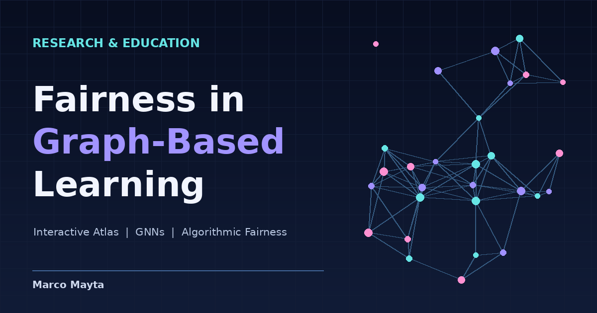

# Fairness in Graph-Based Learning

## Atlas y notebooks sobre equidad en aprendizaje basado en grafos



[Explorar el atlas](https://marcofmayta.github.io/Fairness-in-GBL-MM/) · [Ver el código](https://github.com/marcofmayta/Fairness-in-GBL-MM)

---

## Sobre el proyecto

Los modelos de aprendizaje basado en grafos aprovechan las relaciones entre observaciones para tareas como clasificación de nodos, predicción de enlaces y aprendizaje de representaciones. Sin embargo, esas mismas relaciones pueden contener patrones de segregación, homofilia o desigualdad que terminan influyendo en las predicciones y en la distribución de errores entre grupos.

Este repositorio reúne material para estudiar **fairness** en **Graph-Based Learning (GBL)**, desde las definiciones estadísticas de equidad hasta los mecanismos por los que el sesgo puede aparecer en atributos, etiquetas, estructura del grafo o procesos de entrenamiento.

El proyecto tiene dos componentes principales:

1. **Un atlas web interactivo**, orientado a la exploración conceptual del campo.  
2. **Una colección progresiva de notebooks**, pensada para desarrollar experimentos didácticos y reproducibles.

---

## Qué ofrece este repositorio

- Atlas interactivo con conceptos, taxonomías, fórmulas y referencias.
- Simulaciones didácticas sobre homofilia, propagación e intervenciones estructurales.
- Explorador de métricas de equidad.
- Hoja de ruta de notebooks para profundizar en experimentos y ejemplos reproducibles.
- Recurso orientado a aprendizaje, docencia y exploración inicial del área.

---

## Atlas interactivo

**[Abrir Fairness in GBL](https://marcofmayta.github.io/Fairness-in-GBL-MM/)**

El atlas presenta una organización temática del campo, con explicaciones, fórmulas, referencias y visualizaciones interactivas. Incluye:

- Definiciones de equidad grupal, individual y contrafactual.
- Fuentes de sesgo en atributos, etiquetas y estructura del grafo.
- Homofilia, agregación de vecinos y propagación de información.
- Métodos de mitigación antes, durante y después del entrenamiento.
- Métricas de evaluación y sus posibles incompatibilidades.
- Simulaciones didácticas, glosario y bibliografía consultable.

> **Nota:** las simulaciones del atlas son ilustrativas; no constituyen por sí mismas resultados empíricos de un estudio experimental.

---

## Vista rápida

Puedes añadir aquí una captura o animación del atlas.

### Opción 1: captura estática
```md
